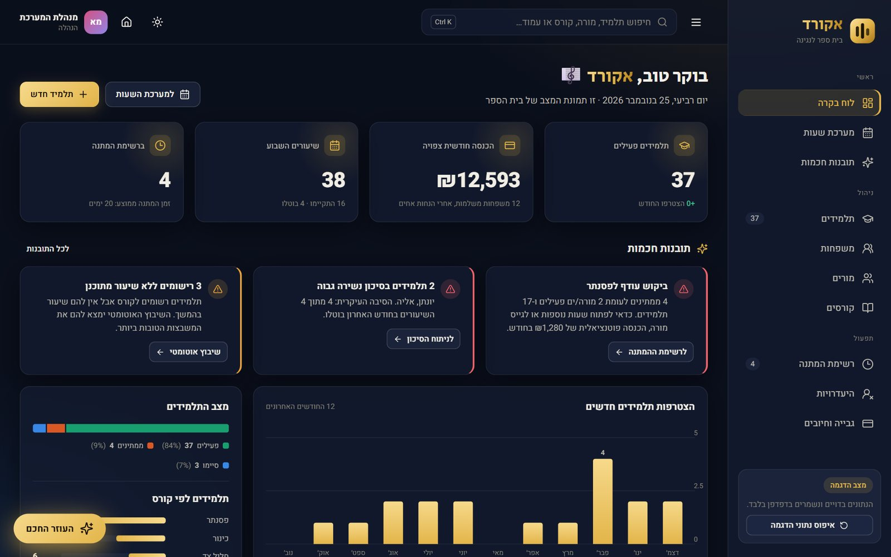
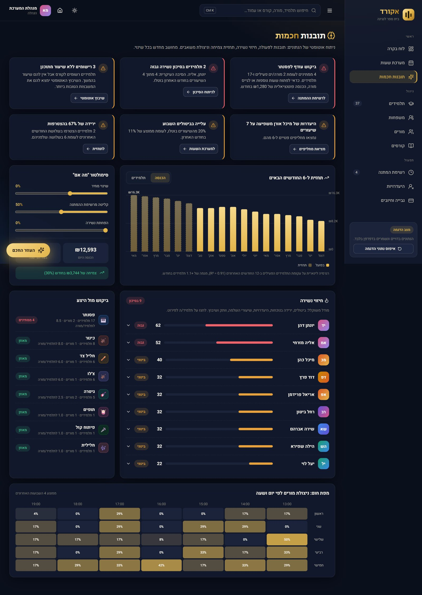
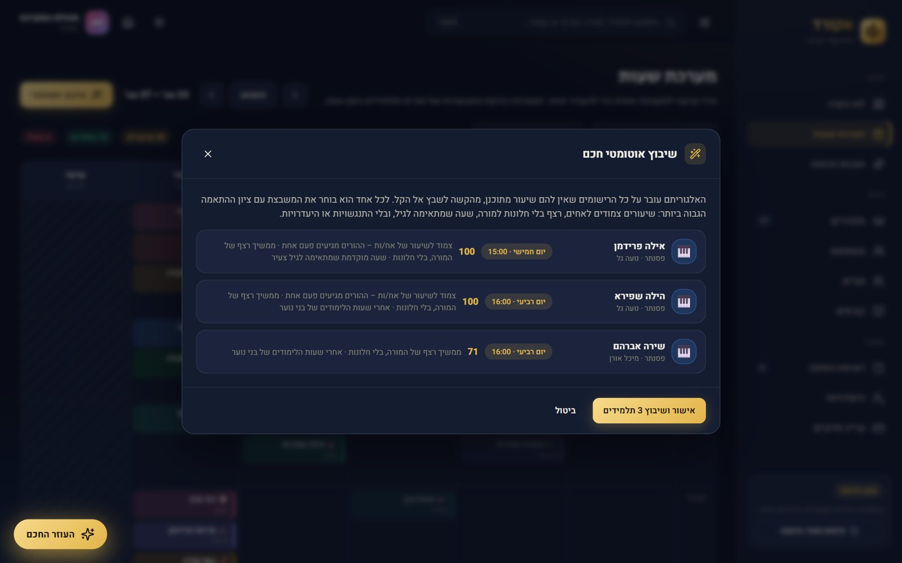
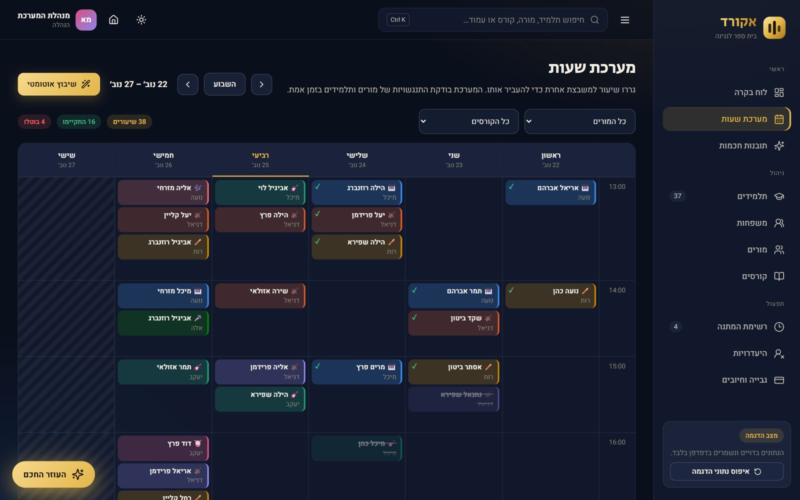
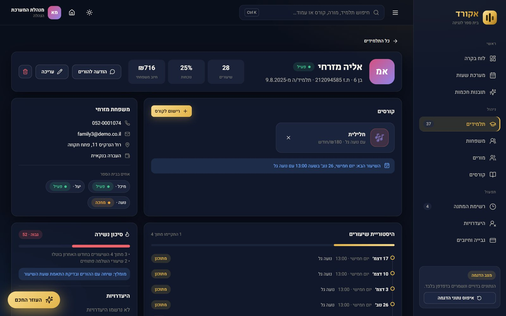
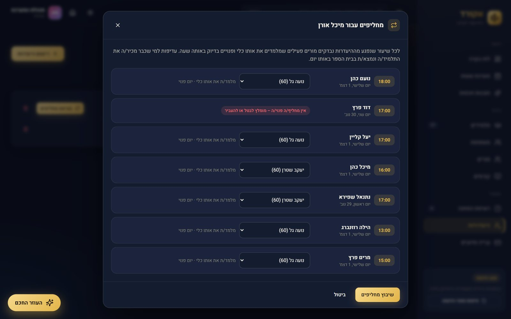
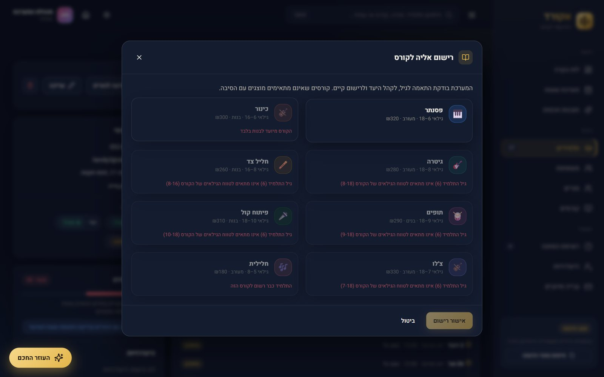
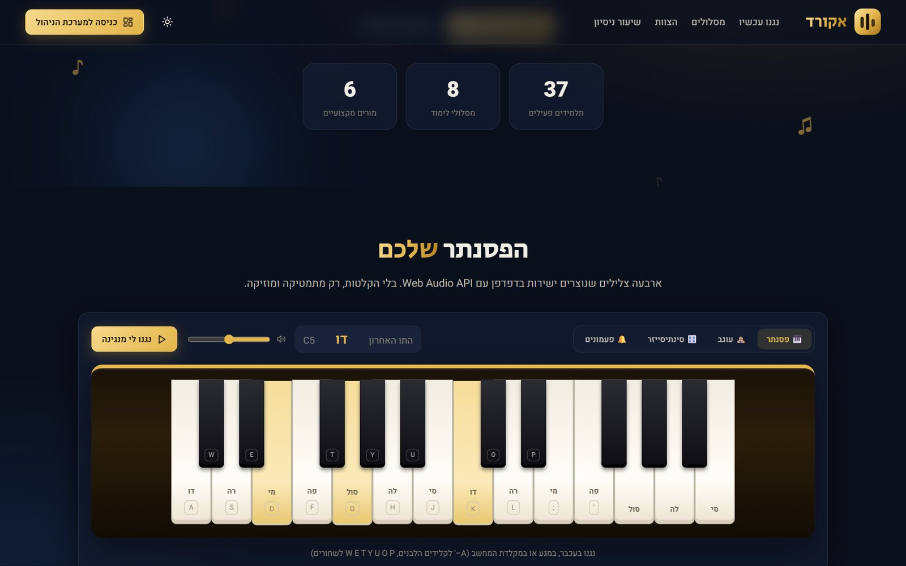
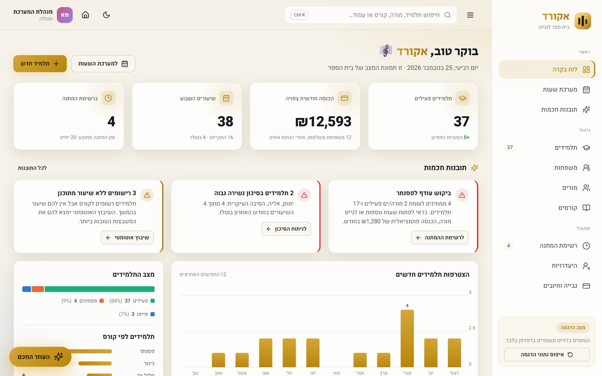
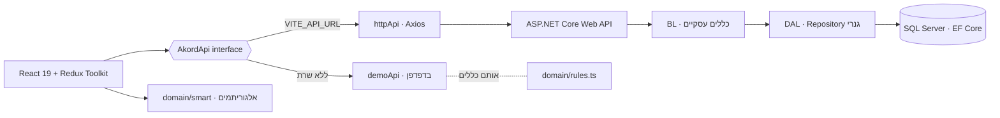

<div dir="rtl" align="right">

# 🎼 אקורד: מערכת חכמה לניהול בית ספר לנגינה

מערכת Full Stack לניהול בית ספר למוזיקה: תלמידים, משפחות, מורים, קורסים, מערכת שעות, רשימת המתנה, היעדרויות וגבייה. מעבר לניהול השוטף, המערכת כוללת **שכבת אלגוריתמים חכמה**: שיבוץ אוטומטי, חיזוי נשירה, תחזית הכנסות, מציאת מורה מחליף ועוזר שעונה על שאלות בעברית.

פותח בשיתוף עם חוי בליזינסקי.

### 🔗 [לצפייה בהדגמה החיה](https://chaya808080.github.io/akord-music-school/)

ההדגמה רצה במלואה בדפדפן עם נתונים בדויים, בלי התקנה. כל הכללים העסקיים פועלים בה בדיוק כמו בשרת.



---

## ✨ פיצ'רים חכמים

| פיצ'ר | מה הוא עושה | איך זה עובד |
|---|---|---|
| **שיבוץ אוטומטי** | מוצא לכל תלמיד את המשבצת השבועית הטובה ביותר ומשבץ את כולם בלחיצה | אילוצים קשיחים (אין התנגשות, אין היעדרות, לא בשבת) + ציון משוקלל לאילוצים רכים: צמוד לשיעור של אח/ות, רצף בלי חלונות למורה, שעה שמתאימה לגיל. אלגוריתם חמדני שמשבץ קודם את הקשים לשיבוץ |
| **חיזוי נשירה** | ציון סיכון 0–100 לכל תלמיד, עם הסיבות ופעולה מומלצת | מודל משוקלל ושקוף: שיעור ביטולים, ירידה בנוכחות לעומת החודש הקודם, היעדרויות, שיעורי השלמה, וותק ושיבוץ |
| **תחזית וסימולטור "מה אם"** | תחזית תלמידים והכנסות לחצי שנה קדימה | רגרסיה לינארית (ריבועים פחותים, כולל R²) על עקומת התלמידים הפעילים, ומעליה תרחישים: שינוי מחיר, קליטת ממתינים, הפחתת נשירה |
| **מציאת מורה מחליף** | לכל שיעור שנפגע מהיעדרות מורה מוצעים מחליפים, ושיבוץ בלחיצה | מסנן מורים פעילים שמלמדים את אותו כלי ופנויים באותה שעה, ומדרג לפי היכרות עם התלמיד ונוכחות בבית הספר באותו יום |
| **עוזר חכם בעברית** | שאלות בשפה חופשית, גם בקול: "מתי השיעור הבא של נועה?", "איזה מורה הכי עמוס?" | מסווג כוונות מבוסס כללים וזיהוי ישויות (שמות תלמידים, מורים, קורסים ומשפחות) מתוך הנתונים החיים. קלט קולי דרך Web Speech API |
| **תובנות אוטומטיות** | כרטיסי תובנה עם פעולה מוצעת: ביקוש עודף לקורס, עלייה בביטולים, מורה עמוס, רישומים בלי שיבוץ | חישובים על כל הנתונים, שמתעדכנים בכל שינוי |
| **מפת חום של ניצולת** | עומס המורים לפי יום ושעה | ממוצע של 4 השבועות האחרונים ביחס למספר המורים הפעילים |
| **מחולל הודעות להורים** | תזכורת לשיעור, פירוט חיוב או בירור על היעדרויות, עם שליחה ב-WhatsApp | תבניות שמתמלאות מהנתונים (השיעור הבא, פירוט החיוב, מספר הביטולים) |

<p align="center"><b>תובנות חכמות: תחזית, סימולטור, חיזוי נשירה ומפת חום</b></p>



<p align="center"><b>שיבוץ אוטומטי עם הסבר לכל החלטה</b></p>



<p align="center"><b>העוזר החכם</b></p>


---

## 🗂️ ניהול

- **מערכת שעות שבועית עם גרירה:** בזמן הגרירה המשבצת נצבעת בירוק או באדום לפי בדיקת התנגשויות. אפשר לסנן לפי מורה או קורס ולסמן שיעור כהתקיים או כבוטל.
- **כרטיס תלמיד:** קורסים, אחוז נוכחות, היסטוריית שיעורים, סיכון נשירה, פרטי משפחה ואחים.
- **רישום חכם לקורס:** קורסים שאינם מתאימים מוצגים עם הסיבה (גיל, קהל יעד, רישום קיים), ומוצגים רק מורים שמלמדים את הקורס.
- **רשימת המתנה:** קליטה לקורס בפעולה אחת, שכוללת רישום, עדכון סטטוס והסרה מהרשימה.
- **גבייה:** חיוב חודשי לכל משפחה עם 10% הנחת אחים, ייצוא ל-Excel והדפסה.
- **חוויית שימוש:** חיפוש מהיר לכל המערכת (Ctrl+K), מצב כהה ובהיר, מימין לשמאל, מותאם למובייל, וטעינה מדורגת של מסכים (code splitting).
- **דף נחיתה:** פסנתר אינטראקטיבי עם 4 צלילים שנוצרים בדפדפן (Web Audio API: מתנדים ומעטפת ADSR), נגינה במקלדת ומנגינה מתנגנת.

| | |
|---|---|
|  |  |
|  |  |
|  |  |

---

## 🏗️ ארכיטקטורה



**צד שרת** ([`server`](server)), ‏.NET 8:
- **שכבות API, BL ו-DAL** עם Dependency Injection. כל בקשה מקבלת DbContext משלה (Scoped).
- **Repository גנרי:** מימוש אסינכרוני אחד ל-13 הטבלאות. המפתח הראשי מתגלה ממודל ה-EF.
- **כללים עסקיים** עם הודעות בעברית:
  - תעודת זהות עם ספרת ביקורת.
  - התאמת גיל ומגדר לקורס.
  - מניעת כפילויות.
  - זיהוי התנגשויות במערכת השעות.
  - בדיקות לפני מחיקה (Referential checks).
- **טיפול בשגיאות** כ-ProblemDetails (RFC 7807), ‏Swagger, ‏CORS מתוך קובץ ההגדרות.
- **מסד הנתונים:** סקריפט יצירה ([`database/schema.sql`](server/database/schema.sql)) שנוצר מהמודל, ונתוני הדגמה שנטענים בסביבת פיתוח.

**צד לקוח** ([`client`](client)), ‏React 19, TypeScript ו-Vite:
- **ממשק API אחד ושני מימושים:** שרת אמיתי, או הדגמה בדפדפן עם אותם כללים בדיוק.
- **שכבת דומיין טהורה** ([`src/domain`](client/src/domain)), נפרדת מהממשק וכולה מכוסה בבדיקות.

---

## ✅ בדיקות ו-CI/CD

- **שרת:** 43 בדיקות xUnit. בדיקות כללים עסקיים על SQLite בזיכרון, ובדיקות אינטגרציה שמריצות את צינור ASP.NET Core המלא (WebApplicationFactory).
- **לקוח:** 37 בדיקות Vitest לכללים, לחיוב, לעקביות נתוני ההדגמה ולכל האלגוריתמים החכמים. למשל: השיבוץ האוטומטי לעולם לא יוצר התנגשות, גם לא בין השיבוצים שהוא עצמו יוצר.
- **GitHub Actions:** בכל שינוי רצים build ובדיקות לשרת וללקוח, ורק אם הכול עובר, ההדגמה החיה מתפרסמת ל-GitHub Pages.

---

## 🚀 הרצה מקומית

```bash
# לקוח (מצב הדגמה)
cd client && npm install && npm run dev

# שרת (‎.NET 8 + SQL Server LocalDB) – יוצר מסד ונתוני הדגמה בהרצה הראשונה
cd server && dotnet run --project API          # https://localhost:7273/swagger
dotnet test Akord.sln

# לקוח מחובר לשרת
cd client && VITE_API_URL=https://localhost:7273/api npm run dev
```

📖 הסבר מפורט על האלגוריתמים: [`docs/HOW-IT-WORKS.md`](docs/HOW-IT-WORKS.md)

</div>
