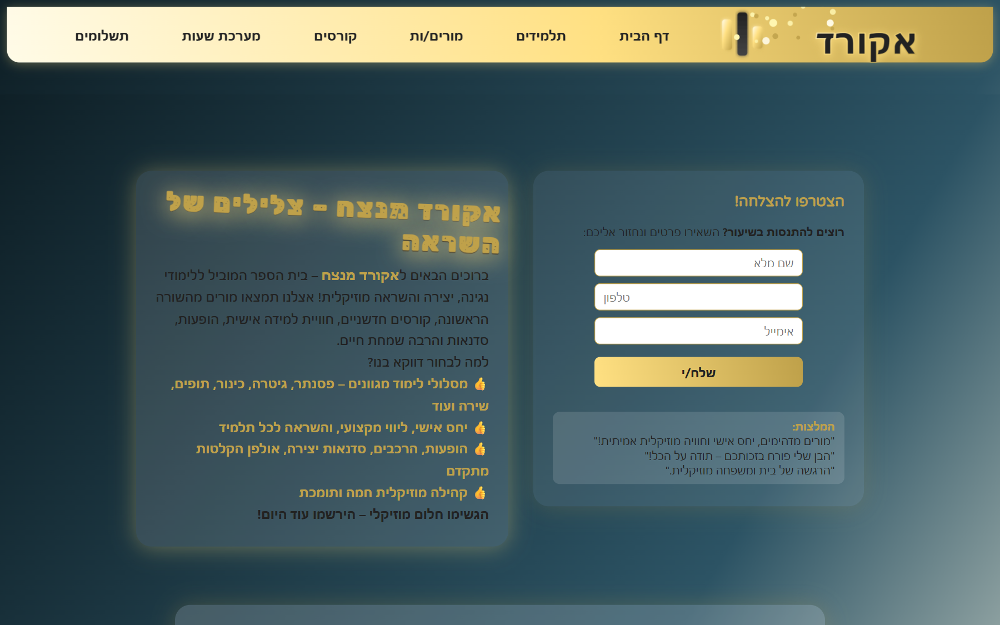
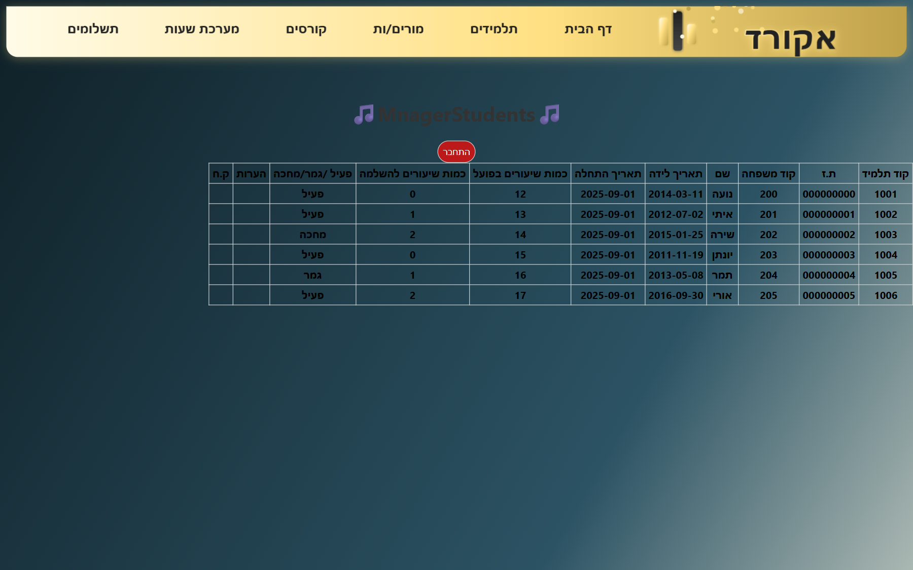
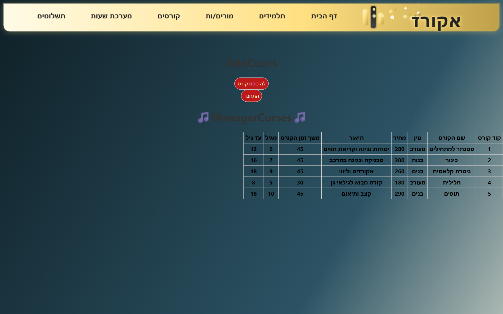

<div dir="rtl" align="right">

# אקורד: מערכת לניהול בית ספר לנגינה

מערכת לניהול בית ספר למוזיקה: תלמידים, משפחות, מורים, קורסים, מערכת שעות שנתית, היעדרויות ורשימת המתנה. היא מורכבת משרת ‎.NET בארכיטקטורת שכבות ומקליינט React עם דף בית אינטראקטיבי.

פותח בשיתוף עם חוי בליזינסקי.

**טכנולוגיות:** C# · ‎.NET 8 · Entity Framework Core · SQL Server · React 19 · Redux Toolkit · React Router · Axios · Web Audio API

---

## מבנה המערכת

| חלק | תיקייה | תפקיד |
|---|---|---|
| שרת | [`server`](server) | שכבת נתונים (DAL) ושכבת לוגיקה עסקית (BL) ב-‎.NET 8 |
| קליינט | [`client`](client) | ממשק ניהול ב-React ודף בית אינטראקטיבי |

```
React + Redux  ──Axios──▶  API  ──▶  BL (Business Logic)  ──▶  DAL (EF Core)  ──▶  SQL Server
```

---

## צד שרת: ‎.NET 8

- **מודל נתונים רלציוני:** 13 טבלאות עם קשרים ביניהן: תלמידים, משפחות, מורים, קורסים, שיוך תלמידים לקורסים, שיוך מורים לקורסים, מערכת שעות שנתית, היעדרויות של תלמידים ומורים, רשימת המתנה, סיום לימודים וסיבות עזיבה.
- **ארכיטקטורת שכבות:**
  - **DAL:** ‏Entity Framework Core מול SQL Server.
  - **BL:** מודלים עסקיים נפרדים ממודלי מסד הנתונים, והמרה ביניהם (`ConvertToBl` / `ConvertToDal`).
- **ממשק CRUD גנרי** (`ICrud<T>`, `IBLCrud<T>`) שכל השירותים מממשים, כדי שהגישה לכל ישות תהיה אחידה.
- **Dependency Injection:** ‏`DalManager` ו-`BLManager` רושמים את כל השירותים ב-`ServiceCollection` ובונים אותם דרך `ServiceProvider`.
- **טיפול בשגיאות בשמירה:** אם השמירה נכשלת, הישות מוסרת מה-Context כדי שהמצב יישאר עקבי.

> שכבת ה-Web API נמצאת בשלבי פיתוח. השכבות שמתחתיה, BL ו-DAL, מלאות.

## צד לקוח: React

- **דף בית אינטראקטיבי:**
  - פסנתר על המסך שמנגן צלילים אמיתיים בעזרת **Web Audio API**. הצלילים מחושבים לפי תדרים, ואפשר לנגן בעכבר או במקלדת.
  - בחירת כלי נגינה, טופס הרשמה לשיעור ניסיון ולוגו SVG מונפש.
- **ניהול תלמידים, קורסים ומורים:** טבלאות שנטענות מהשרת עם Axios ומנוהלות ב-Redux Toolkit (`createSlice`, ‏`configureStore`).
- **ניווט** עם React Router, עיצוב מלא מימין לשמאל וערכת צבעים זהב-כהה.

---

## צילומי מסך (נתוני הדגמה)

> כל השמות והפרטים בצילומים בדויים.

<p align="center"><b>דף הבית</b></p>



<p align="center"><b>ניהול תלמידים</b></p>



<p align="center"><b>ניהול קורסים</b></p>



---

## הרצה מקומית

**קליינט:**
```bash
cd client
npm install
npm start          # http://localhost:3000
```

**שרת** (דורש .NET 8 SDK ו-SQL Server LocalDB):
```bash
cd server
dotnet build Akord.sln
```
את מחרוזת החיבור למסד הנתונים מגדירים ב-`server/Dal/Models/DbManager.cs`.

</div>
